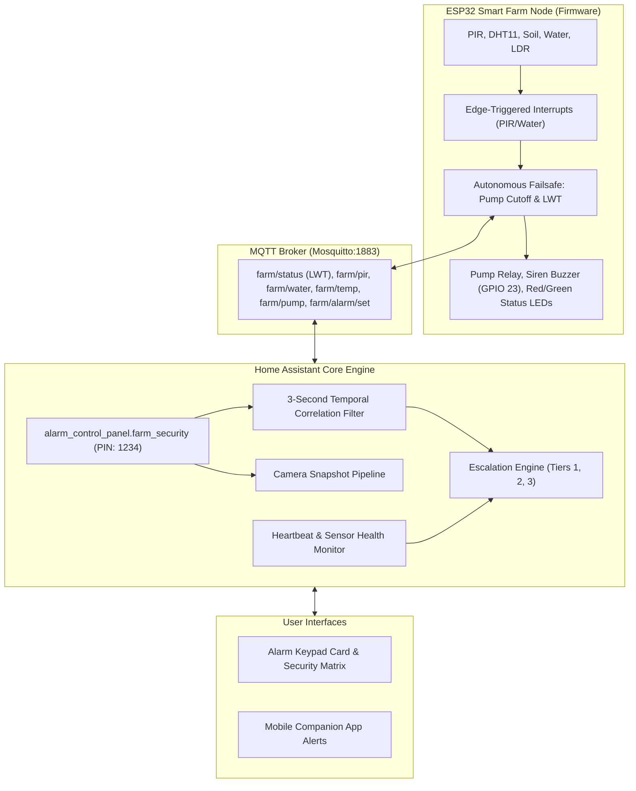

# Design: Unified Smart Farm Security and Safety System

## 1. Intent & Why
Farms face dual operational risks: physical intrusion (wildlife, unauthorized humans, livestock escapes) and environmental/equipment hazards (pump dry-run burnout, freezing temperatures, reservoir depletion, and silent sensor or network blackouts). 

This system provides a unified, defense-in-depth safety and security layer that incorporates authentication, false-positive suppression, multi-tier escalation, local autonomous fallback, and automated resilience testing.

---

## 2. Goals & Non-Goals

### Goals
1. **Authentication & Arming Modes**:
   - Native Home Assistant Alarm Control Panel (`alarm_control_panel.farm_security`) supporting `Disarmed`, `Armed Home`, and `Armed Away` modes with secure 4-digit PIN authentication (default: `1234`).
   - **Mode Definitions**:
     - `Disarmed`: Intrusion alarms disabled. Equipment safety interlocks (pump dry-run cutoff, freeze alerts, network watchdog) remain 100% active.
     - `Armed Home`: Equipment safety active + perimeter alert; PIR field motion is suppressed/bypassed so farm workers can move freely around the homestead without triggering sirens.
     - `Armed Away`: Full intrusion security active. Both PIR motion and perimeter triggers trip the alarm after a 30-second entry delay.
   - Entry/exit delays (30 seconds) to prevent accidental alarm trips when entering or leaving the farm perimeter.
2. **False-Positive Filtering & Event Correlation**:
   - **PIR Temporal Filtering**: A single momentary pulse (< 3 seconds) caused by wind, branches, or insect glitch will not trip the alarm. Motion must remain continuous for $\ge 3$ seconds to confirm intrusion.
   - **LDR Correlation**: Nighttime motion with concurrent optical light shift flags elevated priority.
3. **Equipment Hazard Protection (Hardware Interlocks)**:
   - **Pump Dry-Run Protection**: If the water reservoir sensor (`farm/water`) reads empty (`0`), the water pump relay is forcefully disengaged immediately (< 500ms) to prevent motor burnout, and further pump activation commands are locked out.
   - **Freeze/Frost Warning**: Proactive warning if ambient/soil temperature drops below 2°C (35.6°F) to protect sensitive crops and plumbing.
4. **Connectivity Watchdog & Sensor Health**:
   - MQTT Last Will and Testament (LWT) topic `farm/status` publishing `online` on connect and `offline` automatically upon network loss.
   - Heartbeat watchdog: If no telemetry is received for 30 seconds, an alert indicates `Connectivity Loss / Node Offline`.
   - Sensor fault detection: Flags NaN, flatline, or out-of-physical-range readings (e.g. temperature $< -40^\circ\text{C}$ or $> 80^\circ\text{C}$).
5. **Local Hardware Fallback (Autonomous ESP32 Logic)**:
   - The ESP32 firmware enforces safety autonomously: if water level is 0, the pump relay is cut off locally even if Wi-Fi or Home Assistant is completely down.
   - Edge-triggered publishing: Digital pins (PIR motion and water level) publish immediately on state change rather than waiting for periodic loop timers.
   - Local indicator: Red LED activates when local fault or alarm state is active.
6. **Multi-Tier Escalation Logic**:
   - **Tier 1 (Instant Local Alert)**: ESP32 activates Red alert LED and publishes alarm status; Home Assistant captures camera snapshot to `/config/www/security_snapshot.jpg`.
   - **Tier 2 (Dashboard Broadcast)**: Home Assistant triggers an audio/visual persistent banner and lights up the global notification center.
   - **Tier 3 (Mobile Push & Snapshot)**: Dispatches high-priority push notifications to the user's phone (`notify.roger_phone` / `notify.notify`) with the captured camera image.
7. **Automated Verification & Test Suite**:
   - Standalone test suite (`tests/test_safety_system.py`) that simulates:
     - Scenario A: False alarm spike (brief PIR glitch < 3s $\rightarrow$ verified ignored).
     - Scenario B: Confirmed intrusion (sustained motion $\ge 3$s while Armed Away $\rightarrow$ verified alarm triggered).
     - Scenario C: Sensor failure (malformed/NaN data $\rightarrow$ verified fault flag).
     - Scenario D: Network loss / LWT timeout (broker disconnect $\rightarrow$ verified offline alert).
     - Scenario E: Pump dry-run interlock (pump on with empty tank $\rightarrow$ verified immediate cutoff).

### Non-Goals
- Third-party paid cloud alarm monitoring services.
- High-voltage electrical circuit modification.

---

## 3. Architecture & Data Flow



---

## 4. Entity & Topic Specification

### 1. Alarm Control Panel (`alarm_control_panel.farm_security`)
- **Platform**: `manual`
- **Code**: `1234`
- **Arming States**: `disarmed`, `armed_home`, `armed_away`, `triggered`, `pending`
- **Delays**: `delay_time: 30` (exit delay), `trigger_time: 300` (alarm duration)

### 2. Safety & Security Sensors (Template Sensors)
- `binary_sensor.farm_intrusion_confirmed`: Turns `on` if PIR is active for $\ge 3$ seconds while alarm is `armed_away`.
- `binary_sensor.farm_pump_dry_run_risk`: Turns `on` if pump is ON while water sensor is 0.
- `binary_sensor.farm_node_connectivity`: Evaluates `farm/status` LWT and last telemetry timestamp (online if seen in last 30s).
- `binary_sensor.farm_sensor_health`: Checks if any core sensor reports NaN or out-of-range values.
- `sensor.farm_security_health_summary`: Aggregated status string (`"All Systems Normal"`, `"Perimeter Breach"`, `"Equipment Hazard"`, `"Sensor Failure"`, `"Offline"`).

### 3. ESP32 Firmware Edge-Triggered & Safety Logic
- Topic `farm/status` configured with retain=True and LWT payload `offline`.
- Edge detection for PIR and Water to publish state changes within milliseconds.
- On loop:
  ```cpp
  if (waterVal == 0 && digitalRead(pump) == HIGH) {
    digitalWrite(pump, LOW);
    client.publish("farm/pump/state", "OFF");
    Serial.println("SAFETY INTERLOCK: Dry run prevented!");
  }
  ```

---

## 5. UI/UX Dashboard Integration
- **Keypad Card**: `alarm-panel` card with numeric PIN keypad positioned right below the Satellite Map.
- **System Health Matrix**: Real-time operational status badges:
  - 🛡️ Alarm State (`Disarmed` / `Armed Home` / `Armed Away`)
  - 📶 Farm Node Link (`Online` / `Offline`)
  - 💧 Pump & Reservoir Safety (`Safe` / `Dry-Run Cutoff Active`)
  - 🌡️ Temperature Risk (`Normal` / `Freeze Warning`)
  - 👁️ Perimeter Motion (`Clear` / `Movement Detected`)

---

## 6. Testing & Acceptance Criteria
1. **False Alarm Suppression**: A 1-second pulse to `farm/pir` while Armed Away does not trip the alarm panel.
2. **Confirmed Intrusion**: A continuous $\ge 3$-second signal to `farm/pir` while Armed Away trips the alarm panel to `triggered`, triggers local alert LED, and dispatches notifications.
3. **Dry-Run Interlock**: Publishing `ON` to `farm/pump` while `farm/water` is `0` immediately forces pump to `OFF` and raises an Equipment Hazard alert.
4. **Sensor Failure**: Publishing `nan` to `farm/temp` marks `farm_sensor_health` as `Problem` with red warning.
5. **Connectivity Watchdog**: Disconnecting MQTT client triggers LWT `offline` and flags `farm_node_connectivity` within 15 seconds.
